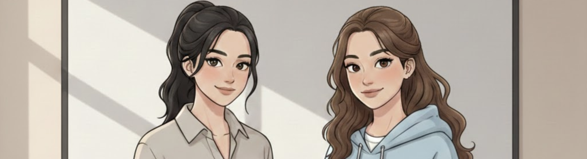

## **BAB 2 — Frekuensi yang Berbeda**

“Oke, sebelumnya aku kenalin dulu,” Silva membuka suara. Ia berdiri di sisi kanan meja dosen dengan pembawaan yang luwes, seolah ruang kelas ini adalah panggung yang sudah biasa ia kuasai.

“Nama aku Silva. Dan ini—” ia memberikan gestur kecil ke arah perempuan di sampingnya, memberikan panggung, “—Hana.”

Perempuan itu hanya mengangguk tipis. Sebuah gestur minimalis yang justru terasa sangat penuh.

“Hai, semuanya.”

Suaranya tidak tinggi, tidak juga datar. Tenang—tipe suara yang tidak perlu berteriak untuk membuat satu ruangan terdiam dan mendengarkan. Juan baru menyadari bahwa sejak detik pertama perempuan itu masuk, punggungnya sudah tegak kaku, seolah tubuhnya mendeteksi kehadiran sesuatu yang menuntut perhatian penuh.

“Dosen kalian hari ini berhalangan hadir,” Silva melanjutkan, suaranya kembali mengambil alih atmosfer. “Jadi sementara, kelas Forensik Digital akan kami dampingi sebagai asisten dosen.”

Gumam kecewa sekaligus lega pecah di beberapa sudut. Ada yang kembali menguap, ada yang mulai asyik dengan *scroll* ponsel. Bagi Juan, informasi itu menguap begitu saja. Fokusnya tertahan pada sosok yang kini berdiri dengan posisi santai di depan kelas.

Hana mengenakan kemeja polos dengan warna netral yang jatuh pas di tubuhnya. Lengan kemejanya digulung rapi hingga siku, memperlihatkan pergelangan tangan yang kokoh namun elegan saat ia memegang tablet. Rambutnya diikat ke belakang tanpa menyisakan satu pun helaian yang nakal. *Bersih. Terukur.* Juan menangkap dirinya berpikir: *Rambut diikat begitu ternyata bisa kelihatan sangat... pas.*

Ia buru-buru membuang muka, merasa konyol dengan pikirannya sendiri.

“Kita mulai dari pengenalan singkat dulu,” ujar Hana. “Mata kuliah ini bakal banyak praktik, jadi kalian bakal sering kerja kelompok.”

Silva adalah mesin penggerak kelas; ia banyak bicara, melontarkan lelucon, dan mencairkan suasana. Sementara Hana? Ia adalah jangkar. Ia hanya menambahkan seperlunya, namun setiap kalimatnya terasa punya bobot yang berbeda. Jika Silva adalah permukaan air yang beriak, Hana adalah kedalaman yang tenang di bawahnya.

Juan mencoba mencatat, tapi jemarinya terasa kikuk. Pikirannya sibuk bernegosiasi dengan istilah-istilah forensik yang terdengar mirip dengan dunia *software engineering* yang ia cintai, namun memiliki niat yang bertolak belakang. Engineer membangun; forensik membongkar sisa-sisa reruntuhan.

Saat sesi praktik dimulai, kelas berubah menjadi laboratorium kecil yang bising. Laptop-laptop berdengung. Juan dan Nino merapat, kepala mereka hampir bersentuhan di depan satu layar.

“Ini maksudnya gimana sih? Kita disuruh nyari apa?” bisik Nino bingung.

“Analisis file, No. Kita nyari apa yang disembunyiin di balik data yang kelihatan,” jawab Juan pelan, matanya menyipit menatap barisan heksadesimal.

Langkah kaki yang teratur terdengar mendekat. Juan merasakannya sebelum ia melihatnya. Hana sedang berkeliling, berhenti di beberapa meja untuk memberikan arahan singkat, lalu melanjutkan langkah. Saat Hana sampai di barisan belakang—zona kekuasaan Juan dan Nino—Juan secara refleks memperbaiki duduknya.

“Kalian gimana? Ada kendala?” tanya Hana.

Juan menelan ludah. Tenggorokannya mendadak kering.

“Ehm—Kak.”

Hana menoleh sepenuhnya pada Juan. Tatapannya tenang, menunggu.

“Kak Hana,” lanjut Juan, mencoba terdengar seprofesional mungkin. “Kalau file-nya sudah di-extract, tapi metadata-nya nggak kebaca semua, itu tandanya korup atau ada enkripsi lain?”

Juan sebenarnya punya jawaban di kepalanya. Ia tahu kemungkinan besarnya. Namun, ada dorongan aneh untuk mendengar jawaban itu langsung dari mulut Hana.

Hana sedikit membungkuk untuk melihat layar laptop Juan. Jarak yang tercipta cukup dekat untuk membuat Juan menangkap aroma parfum ringan—aroma yang bersih, mirip wangi hujan di atas aspal yang panas, tidak menyengat tapi menetap.

“Bisa dua-duanya,” jawab Hana tanpa mengalihkan pandangan dari layar. “Tapi untuk kasus ini, kemungkinan besar karena format aslinya sengaja diubah secara manual. *Header*-nya rusak.”

“Oh,” Juan mengangguk perlahan, berpura-pura baru menyadari hal itu. “Berarti masih ada harapan buat ditelusuri lewat log awalnya, ya?”

Hana mengalihkan tatapannya dari layar, langsung ke mata Juan. Senyum tipis—sangat tipis hingga hampir tak terlihat—muncul di sudut bibirnya. “Masih. Coba kamu cek dari sana.”

“Iya, Kak.”

Kontak mata itu hanya bertahan dua detik. Singkat, namun cukup untuk membuat denyut di pergelangan tangan Juan berpacu sedikit lebih cepat.

Hana melangkah pergi menuju meja lain. Juan mengembuskan napas yang ternyata sedari tadi ia tahan.

“Wan,” bisik Nino, matanya memicing curiga. “Lu nanya detail amat kayak lagi ujian skripsi.”

“Biar ngerti, Bre. Kan mahal bayar kuliah,” sahut Juan cepat, tangannya sibuk mengetik apa saja di keyboard agar terlihat sibuk.

Padahal, bukan penjelasan teknis itu yang tertanam di kepalanya. Melainkan cara Hana memanggilnya “kamu”—tanpa jarak yang canggung, namun tetap penuh wibawa. Cara ia tidak menggurui, melainkan mengajak berpikir.

Kelas berakhir beberapa saat kemudian. Juan menutup laptopnya perlahan, seolah sedang melakukan ritual yang sakral. Ia tidak tahu mengapa hatinya merasa sedikit lebih ringan, atau mengapa ia merasa semester tiga ini akan menjadi perjalanan yang jauh lebih menarik daripada sekadar belajar tentang data yang hilang.

Ia hanya tahu satu hal: frekuensi di ruangan ini baru saja berubah.

---

